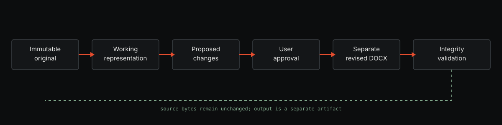

<div align="center">
  
  <p><strong>Academic writing and document intelligence workspace</strong></p>
  <p>A local-first tool for inspecting research documents, improving selected paragraphs, reviewing citations, and exporting controlled revisions.</p>
  <p>
    
    
    
    
  </p>
</div>

<p align="center"></p>

> Academic Humanizer is designed for reviewable, source-preserving work. It does not promise plagiarism scores, AI-detector scores, or automatic research validation.

<h2> Contents</h2>

- [1. Introduction](#1-introduction)
- [2. Features](#2-features)
- [3. Screenshots](#3-screenshots)
- [4. CLI screenshots](#4-cli-screenshots)
- [5. Architecture](#5-architecture)
- [6. Processing workflow](#6-processing-workflow)
- [7. Dashboard](#7-dashboard)
- [8. CLI Usage](#8-cli-usage)
- [9. Supported formats](#9-supported-formats)
- [10. Writing modes](#10-writing-modes)
- [11. Provider configuration](#11-provider-configuration)
- [12. Academic integrity](#12-academic-integrity)
- [13. Citation intelligence](#13-citation-intelligence)
- [14. Similarity review](#14-similarity-review)
- [15. Formatting preservation](#15-formatting-preservation)
- [16. Installation](#16-installation)
- [17. Environment configuration](#17-environment-configuration)
- [18. Running locally](#18-running-locally)
- [19. API documentation](#19-api-documentation)
- [20. Testing and verification](#20-testing-and-verification)
- [21. Privacy and security](#21-privacy-and-security)
- [22. Current limitations](#22-current-limitations)
- [23. Contributing](#23-contributing)
- [24. License](#24-license)

<h2> 1. Introduction</h2>

Academic Humanizer is a monorepo with a Next.js dashboard, FastAPI service, shared Python engine, Typer CLI, and SQLite metadata store.

The application currently supports:

- Local DOCX, PDF, and TXT ingestion.
- Ordered document structure extraction.
- Paragraph-level provider-backed writing suggestions.
- Immutable originals and accepted-change DOCX export.
- Citation and bibliography analysis.
- DOI metadata lookup through Crossref and OpenAlex adapters.
- Internal repetition and explicit local-source similarity review.
- Finding review and dismissal with evidence and confidence.
- Provider connection tests without exposing credentials.

The source of truth is the implementation in `packages/engine`, `apps/api`, `apps/dashboard`, and `packages/cli`.

<h2> 2. Features</h2>

| Area | Implemented behavior |
| --- | --- |
| Document intelligence | DOCX structure, runs, styles, tables, sections, images, PDF text extraction, OCR-required detection |
| Writing intelligence | Seven modes, bounded context, structured provider output, validation warnings, paragraph-level review |
| Integrity review | Citation matching, DOI extraction, unsupported-claim heuristics, quotation attribution warnings, repeated passages |
| Preservation | Original hash tracking, separate revised output, stable element checks, conservative multi-run handling |
| Local operations | SQLite schema migrations, local files, Typer commands, FastAPI versioned API |

<h2> 3. Screenshots</h2>

The screenshots below were captured from the running Next.js dashboard and FastAPI API using a non-sensitive demo DOCX.

### Overview


### Document library


### Upload


### Analysis workspace


### Integrity review


### Provider settings


The writing comparison panel is implemented in the document workspace, but a genuine revised suggestion screenshot was not captured because no live AI provider was configured in this environment. The workspace therefore remains in its real pending-provider state rather than showing fabricated output.

<h2> 4. CLI screenshots</h2>

The CLI commands were verified directly with the repository-local executable. A window-level terminal screenshot could not be captured in the current headless desktop session, so no synthetic terminal image is included. This avoids presenting rendered text as a screenshot of a real terminal.

Verified output states:

```text
academix --help       -> command list rendered
academix doctor       -> local services ready
academix providers list -> OpenAI, Anthropic, Gemini, and Ollama status rendered
```

The exact command examples and provider-unavailable behavior are documented in the [CLI](#-cli) section below.

<h2> 5. Architecture</h2>


| Layer | Location | Responsibility |
| --- | --- | --- |
| Dashboard | `apps/dashboard` | Browser UI, document library, writing review, integrity review, provider status |
| API | `apps/api` | FastAPI lifespan, validation, versioned routes, CORS, error boundary |
| Shared engine | `packages/engine` | Parsing, storage, providers, writing, integrity, similarity, export |
| CLI | `packages/cli` | Local commands using the same engine services |
| Storage | `storage/` | SQLite metadata and UUID-scoped original documents |

<h2> 6. Processing workflow</h2>


Documents are copied into a UUID-named local directory after validation. The original upload is never overwritten. Provider calls occur only when a user requests a writing suggestion.

<h2> 7. Dashboard</h2>

Routes currently present:

- `/` — overview and local workspace status.
- `/documents` — real document listing, upload, and deletion.
- `/documents/new` — drag-and-drop or file-browser upload.
- `/documents/[documentId]` — structure, writing workspace, export, and integrity review.
- `/settings` — local workspace settings.
- `/settings/providers` — provider readiness and connection tests.

The interface uses the existing obsidian palette, editorial serif document text, compact navigation, and custom inline SVG marks. It does not use Lucide, emoji, purple gradients, or fabricated analytics.

<h2> 8. CLI Usage</h2>

The installed `academix` command uses the same shared engine as the API:

```bash
academix --help
academix doctor
academix init --workspace "Research Workspace"
academix providers list
academix providers test --provider ollama
academix analyze research-paper.docx
academix analyze-writing research-paper.docx
academix compare research-paper.docx source-paper.docx
academix improve research-paper.docx --mode academic
academix export research-paper.docx --format docx
academix serve --port 8000
```

`improve` requests a real configured provider and asks for explicit approval before writing a separate revised DOCX. `providers test` reports connection failure when the configured endpoint cannot be reached.

<h2> 9. Supported formats</h2>

- **DOCX** — validated ZIP package, ordered paragraphs and tables, styles, runs, sections, relationships, images, citations, and references.
- **PDF** — text extraction with page and block analysis. Image-only pages report that OCR is required; OCR is not silently performed.
- **TXT** — UTF-8 text ingestion for lightweight analysis.

PDF layout-preserving editing is not implemented.

<h2> 10. Writing modes</h2>

The writing engine supports:

1. Academic Research
2. Formal Academic
3. Technical Research
4. Simple Academic
5. Professional Report
6. Concise Academic
7. Research Explanation

The engine preserves numbers, dates, citations, technical terms, quotations, negation, and uncertainty where the provider response allows validation. Warnings block automatic acceptance.

<h2> 11. Provider configuration</h2>


Supported adapters:

- OpenAI Chat Completions.
- Anthropic Messages API.
- Google Gemini `generateContent`.
- Ollama `/api/chat`.

Configure credentials in `.env`, never in browser code:

```dotenv
ACADEMIX_OPENAI_API_KEY=
ACADEMIX_ANTHROPIC_API_KEY=
ACADEMIX_GOOGLE_API_KEY=
ACADEMIX_OLLAMA_BASE_URL=http://127.0.0.1:11434
```

Test a provider before requesting writing work:

```bash
academix providers test --provider openai
# or: ollama, anthropic, google
```

The provider page distinguishes `not configured`, `not tested`, `connection_successful`, and connection failure. In this repository environment, no live AI provider request has been verified.

<h2> 12. Academic integrity</h2>


The integrity service reports evidence for human review; it does not determine plagiarism.

Implemented checks include:

- APA/Harvard/Chicago-style author-year patterns.
- IEEE numeric citation patterns.
- Bibliography extraction.
- Citation-to-reference matching.
- Missing and unreferenced bibliography entries.
- DOI extraction.
- Citation consistency warnings.
- Potentially unattributed direct quotations.
- Potentially unsupported factual constructions.
- Repeated passages within a document.
- Similarity against explicitly supplied local source documents.
- Crossref and OpenAlex metadata verification adapters.

Metadata matches do not prove that a source supports a claim. The application does not access Turnitin, iThenticate, restricted academic databases, or the full internet.

<h2> 13. Citation intelligence</h2>

Citation intelligence currently extracts author-year and IEEE-like in-text citations, bibliography entries, DOIs, publication years, and author names. It compares citations with references and reports missing, unreferenced, inconsistent, or unverifiable entries with evidence and confidence.

Supported style detection includes APA 7, IEEE, Harvard, MLA, and Chicago heuristics. This is a review aid rather than a full style-guide validator.

<h2> 14. Similarity review</h2>

Similarity review has two deliberately bounded inputs:

- Repeated passages within the uploaded document.
- Overlap against an explicitly supplied local comparison document.

Each result includes matching text and source location where available. No internet-wide similarity percentage is generated, and no restricted academic service is implied.

<h2> 15. Formatting preservation</h2>


Accepted suggestions are applied to a separate output DOCX. The source hash and source bytes remain unchanged.



Current safeguards:

- Stable positional element IDs plus original-text verification.
- Separate source and output paths.
- Tables and body-block ordering retained.
- Headers, footers, sections, images, and references retained through loading the original package.
- Incompatible multi-run formatting is rejected instead of flattened.
- Exported DOCX is reopened in automated tests.

Advanced OOXML fields, equation fidelity, complex numbering, and every layout edge case are not guaranteed and should be validated for high-stakes documents.

<h2> 16. Installation</h2>

Requirements:

- Python 3.9 or newer.
- Node.js 18.17 or newer.
- npm.

```bash
git clone <repository-url>
cd Academix
python3 -m venv .venv
source .venv/bin/activate
python -m pip install --upgrade pip
pip install -e packages/engine -e apps/api -e packages/cli
cp .env.example .env
cd apps/dashboard
npm install
cd ../..
```

<h2> 17. Environment configuration</h2>

Supported environment variables are documented in [.env.example](.env.example):

| Variable | Purpose |
| --- | --- |
| `ACADEMIX_APP_ENV` | API environment label |
| `ACADEMIX_DATABASE_PATH` | SQLite database path |
| `ACADEMIX_DOCUMENTS_PATH` | Immutable local document storage |
| `ACADEMIX_TEMP_PATH` | Temporary upload storage |
| `ACADEMIX_API_HOST` / `ACADEMIX_API_PORT` | API bind address |
| `ACADEMIX_CORS_ORIGINS` | Allowed dashboard origins |
| `ACADEMIX_MAX_UPLOAD_BYTES` | Upload limit |
| `ACADEMIX_LOG_LEVEL` | Python logging level |
| `ACADEMIX_OPENAI_API_KEY` | Server-side OpenAI credential |
| `ACADEMIX_ANTHROPIC_API_KEY` | Server-side Anthropic credential |
| `ACADEMIX_GOOGLE_API_KEY` | Server-side Gemini credential |
| `ACADEMIX_OLLAMA_BASE_URL` | Local Ollama endpoint |

<h2> 18. Running locally</h2>

Start API and dashboard together:

```bash
source .venv/bin/activate
./scripts/dev.sh
```

The script uses `.venv/bin/academix`, so shell activation is still required for the Python environment but the command itself does not depend on the caller's `PATH`.

Or run separately:

```bash
academix serve
cd apps/dashboard && npm run dev
```

Open `http://localhost:3000`. API health is available at `http://127.0.0.1:8000/api/v1/health`; OpenAPI documentation is at `http://127.0.0.1:8000/api/docs`.

<h2> 19. API documentation</h2>

The FastAPI service publishes interactive OpenAPI documentation at `/api/docs` and the schema at `/api/openapi.json`. The versioned route surface includes health/configuration, document upload and analysis, suggestions, integrity findings, export, and provider connection testing.

The dashboard calls the API through `NEXT_PUBLIC_API_URL`; the default local development target is `http://127.0.0.1:8000/api/v1`.

<h2> 20. Testing and verification</h2>

```bash
.venv/bin/ruff check packages/engine/src apps/api/src packages/cli/src tests
.venv/bin/ruff format --check packages/engine/src apps/api/src packages/cli/src tests
.venv/bin/pytest -q
cd apps/dashboard
npm test
npm run build
```

The repository currently has 22 passing Python tests. Dashboard TypeScript validation and the production build pass. Provider tests use mocked responses unless valid credentials and a reachable provider are configured.

<h2> 21. Privacy and security</h2>

- Documents and metadata remain local by default.
- Original uploads are never overwritten.
- API keys stay server-side and are excluded from safe configuration responses.
- Uploads are extension- and structure-validated.
- Temporary uploads are removed after processing.
- Storage paths are UUID-scoped and traversal-checked.
- No uploaded document is sent externally unless a user requests a provider-backed writing suggestion.

`npm audit` currently reports one critical Next.js advisory chain and one high PostCSS advisory. The available fix requires a breaking Next.js 16 upgrade from the pinned Next.js 14 setup. It has not been applied blindly; this remains a documented upgrade task.

<h2> 22. Current limitations</h2>

- No live AI provider was available during this documentation capture.
- OCR is not implemented.
- PDF editing is not implemented.
- Complex OOXML formatting requires conservative rejection or manual validation.
- Similarity review is limited to internal content and explicitly supplied local comparison files.
- Crossref/OpenAlex metadata verification does not validate claim support.
- No plagiarism score or AI-detector score is produced.
- Processing is synchronous; very large documents and slow providers need further operational benchmarking.

<h2> 23. Contributing</h2>

Keep parsing, writing, integrity, storage, and preservation behavior in `packages/engine`. Add focused tests before changing API routes or dashboard behavior. Run the Python and dashboard verification commands above before submitting changes. Do not add credentials, private documents, generated `.next` output, or local SQLite data.

<h2> 24. License</h2>

No license file is currently declared in this repository. Add an explicit license before distributing the project as open-source software.

<h2> Asset index</h2>

- Product identity: [`assets/branding/`](assets/branding/)
- README icons: [`docs/assets/icons/`](docs/assets/icons/)
- Architecture diagrams: [`docs/assets/diagrams/`](docs/assets/diagrams/)
- Captured dashboard screenshots: [`docs/assets/screenshots/`](docs/assets/screenshots/)
